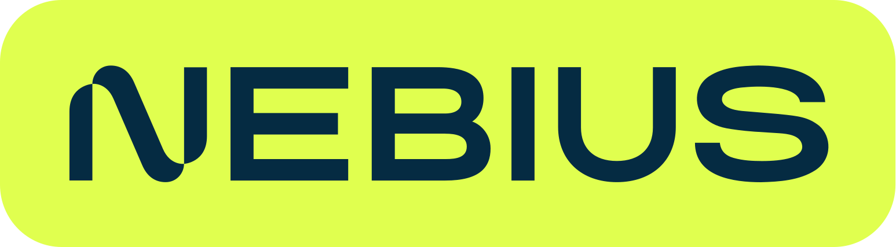

<p align="center">
  
</p>

<h1 align="center">Less tab-hopping. More holiday.</h1>

<p align="center">
  Your AI travel-planning workspace: turn scattered ideas into a trip you can explore, refine, and make your own.
</p>

<p align="center">
  <strong>Built to compete in the <a href="https://nebiusglobalaihackathon.devpost.com/">Nebius x NVIDIA Hackathon</a></strong>
</p>

<p align="center">
  
  
</p>

<p align="center">
  <a href="https://onholidai.nl">Website</a> |
  <a href="#run-it-locally">Run locally</a> |
  <a href="#how-the-agent-works">Agent architecture</a>
</p>

## One trip. Not twenty browser tabs.

Planning a holiday means piecing together destinations, dates, flights, hotels, activities, and advice from disconnected tools. Change one thing, and the research starts again.

**OnHolidai brings the plan and the conversation into one workspace.** Start with where you want to go, when you can travel, and what matters to you. Explore a route on the globe, research travel options, and ask the agent to reshape your draft as your ideas evolve.

Our hackathon thesis is simple: **a useful travel agent should do more than write an itinerary. It should connect research, supplier evidence, and a plan you can safely change.**

### What makes it different

- **Start planning, not registering.** Start building your next getaway with no sign-up. Save it to a free account when you're ready.
- **Your route, your rules.** Choose countries or cities, multiple departure alternatives, flexible availability windows, trip duration, and travel preferences. Keep **My order**, or **Let AI arrange** the route.
- **A conversation with a working plan.** Ask questions or request changes alongside your itinerary and map. New planning requests can apply validated draft changes automatically, with a change summary and a version checkpoint.
- **Research connected to travel supply.** Combine place and web research with flight, accommodation, and activity offers, keeping source evidence separate from model-generated advice.
- **Room to change your mind.** Restore an earlier eligible trip checkpoint without deleting history. Restoring a plan does not cancel reservations.
- **Planning is not purchasing.** Booking has its own review, live-term revalidation, and exact-action authorization. A chat message, sign-in, or page visit is not payment consent.

## Built for the Nebius x NVIDIA Hackathon

This project puts agentic AI to work on a familiar, multi-step problem: coordinating a holiday across research tools and travel suppliers.

**Nebius Token Factory powers live model inference** through its OpenAI-compatible API and serves [NVIDIA Nemotron models](https://nebius.com/services/token-factory/models/nvidia-nemotron-models-inference) for reasoning and agentic workflows. A FastAPI/LangGraph agent combines that reasoning with destination research and travel discovery to build a plan around you.

The result is a hackathon prototype with a real application boundary: a guest-to-account journey, versioned plans, explicit source availability, and a separate booking workflow. The local demo also runs with deterministic doubles, so reviewers can explore the experience without paid API keys or real transactions.

## How the agent works



### The connected toolchain

| Connection      | Endpoint                             | What it contributes                                                     |
| --------------- | ------------------------------------ | ----------------------------------------------------------------------- |
| **Nebius**      | Token Factory, OpenAI-compatible API | NVIDIA Nemotron models for reasoning and conversational travel planning |
| **Google Maps** | Grounding Lite MCP                   | Place discovery and local context for your destinations                 |
| **Tavily**      | `/search` API                        | Web research to help you explore and understand a destination           |
| **Duffel**      | Flights API                          | Flight options that connect your route                                  |
| **Nuitee**      | LiteAPI                              | Accommodation options for each stop                                     |
| **Viator**      | Partner API                          | Experiences and activities that bring your trip to life                 |

**Connected travel research.** The agent explores flights, stays, and activities through OnHolidai's own connections to Duffel, Nuitee, and Viator. It helps you explore options, but cannot book, cancel, or change reservations.

**Try it without paid API keys.** The local demo uses sample AI responses and travel offers, so you can explore without real transactions. Live research requires your own API keys and approved provider access. This is a hackathon prototype, not a production booking service.

## Run it locally

### Prerequisites

- **Git**, **Bash**, **OpenSSL**, and **curl** for the commands below.
- **Docker Engine** or **Docker Desktop** running Linux containers, with **Docker Compose v2** available in your chosen shell.
- Available ports: `3000` (web), `8000` (agent), `5432` (PostgreSQL), `7233` (Temporal), `8080` (Temporal UI), `16686` (Jaeger), and `4317`, `4318`, `13133` (OpenTelemetry).

The recommended path builds and runs the application inside Docker. Host Node.js and Python installations are not required. Run commands from the repository root.

### 1. Set up

```bash
git clone https://github.com/Rubinjo/onholidai.git
cd onholidai
cp .env.example .env
```

Already have a checkout? Use it instead. Do not overwrite an existing `.env`. Leave `PROVIDER_MODE=deterministic` for the demo. The example secrets are for local use only.

### 2. Start the app

```bash
docker compose --env-file .env -f infra/compose/compose.yml --profile infrastructure --profile applications up -d --build
```

The first build may take a while. A booking worker is **not needed** for guest planning, research, refinement, or account linking.

### 3. Open the app and check health

- **Application:** <http://localhost:3000>
- **Start a trip:** <http://localhost:3000/trips/new>
- **Agent API docs:** <http://localhost:8000/docs>
- **Temporal UI:** <http://localhost:8080>
- **Jaeger:** <http://localhost:16686>

```bash
curl -fsS http://localhost:3000/api/health
curl -fsS http://localhost:8000/health
```

The agent response should report `status: ok` and `providerMode: deterministic`. To stop the local stack:

```bash
docker compose --env-file .env -f infra/compose/compose.yml --profile infrastructure --profile applications down
```

### Switch to live AI and research

After the deterministic demo works, edit your local `.env`:

1. Set `PROVIDER_MODE=live`.
2. Supply `NEBIUS_API_KEY` and a `NEBIUS_MODEL` available to your account. Choose a supported [NVIDIA Nemotron model](https://nebius.com/services/token-factory/models/nvidia-nemotron-models-inference) for the NVIDIA-powered setup shown above. The default endpoint is `https://api.tokenfactory.nebius.com/v1`.
3. Supply `MAPS_GROUNDING_API_KEY` for Google Maps Grounding Lite, with Places and Time Zone APIs enabled for the web lookup path.
4. Supply `TAVILY_API_KEY` for web research.
5. For supplier discovery, supply `DUFFEL_READ_SECRET`, `NUITEE_SECRET`, and `VIATOR_SECRET` as needed. Keep the corresponding references in `SUPPLIER_PROVIDERS`. The template intentionally declares only unverified read operations, not transaction authority.
6. Recreate the application containers to apply the environment:

```bash
docker compose --env-file .env -f infra/compose/compose.yml --profile infrastructure --profile applications up -d --build
```

Live requests may incur provider charges. Missing supplier access, unsupported destinations, and incomplete readiness evidence can still make individual sources unavailable. See [the operations guide](docs/operations.md) for provider verification, mappings, diagnostics, and recovery. Do not use real customer or payment data for the demo, publish environment dumps, or commit credentials.

## Under the hood

| Layer                     | Technology                                                           |
| ------------------------- | -------------------------------------------------------------------- |
| Product experience        | Next.js 16, React 19, TypeScript, Tailwind CSS, MapLibre             |
| Agent service             | Python 3.13, FastAPI, LangGraph, FastMCP                             |
| Live model inference      | Nebius Token Factory, OpenAI-compatible API                          |
| Durable application state | PostgreSQL 18 + PostGIS, versioned trip snapshots and offer evidence |
| Booking orchestration     | Temporal with a separate TypeScript worker                           |
| Observability             | OpenTelemetry collector, Jaeger, redacted LangSmith traces           |

### Development and validation

Host-side development uses **Node.js 24**, **pnpm 12**, **Python 3.13**, and **uv**. Install locked dependencies from the repository root:

```bash
pnpm install --frozen-lockfile
uv sync --project agent --frozen
```

Host-run web, migration, and worker processes derive their database URLs from the role passwords in `.env`; Compose builds its internal service URLs from those same values. Next.js and the migration entrypoint do not automatically load the repository-root `.env` when run from another working directory. Pass it explicitly, for example with Node's `--env-file`.

Before pushing, reproduce the CI formatting and Python type checks:

```bash
pnpm --filter @onholidai/web format:check
uv run --project agent pyright --project agent
```

Despite the package filter, the formatting command checks maintained source, configuration, and documentation across the repository. Use `pnpm --filter @onholidai/web format` to apply formatting. Correct Python type errors rather than disabling strict checks.

Run the relevant application suites with the stack and test prerequisites in place:

```bash
pnpm lint
pnpm typecheck
pnpm test
pnpm test:contracts
pnpm test:e2e
```

`pnpm test` runs both web and agent suites. Contract checks cover generated-contract drift and both contract suites. Empty test selections are errors. Database integration tests need isolated `TEST_DATABASE_*` credentials, and browser tests need the local stack and Playwright browsers. Never point tests at production data.

To regenerate the branded diagram after editing its Mermaid source or logo assets, install the Playwright browser and run the generator:

```bash
pnpm --dir web exec playwright install chromium
node web/scripts/generate-agent-diagram.mjs
```

The generator uses the existing web development dependencies and downloads a pinned Mermaid CLI through npm on first use. It embeds the logo artwork into the final SVG.

## Explore the project

- [Web application](web/) and [planning agent](agent/): the product and orchestration code.
- [Development and testing](docs/development.md): host-run development, focused checks, and isolated test databases.
- [Shared contracts](contracts/README.md): the APIs and data formats connecting the workspace, agent, and travel providers.
- [Operations guide](docs/operations.md): migrations, provider readiness, recovery, retention, and pricing controls.
- [Production runbook](infra/production/README.md): the separate Leaseweb VPS deployment, Caddy TLS, GHCR releases, backups, and rollback.
- [Brand assets](web/public/logo/): application, event, and integration logos. When changing the application icon, regenerate both PNG variants from the SVG, preserving aspect ratio, transparent favicon padding, and the Apple icon's white background.

## License

Released under the [MIT License](LICENSE). Third-party names and logos belong to their respective owners. Their inclusion identifies the competition and integrations, not an endorsement.
